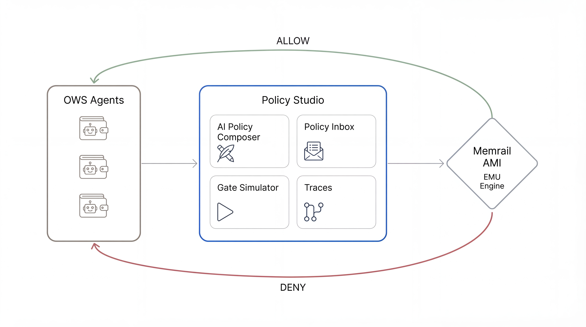
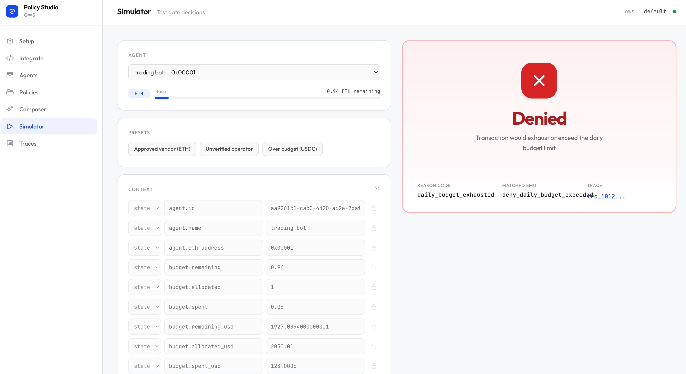
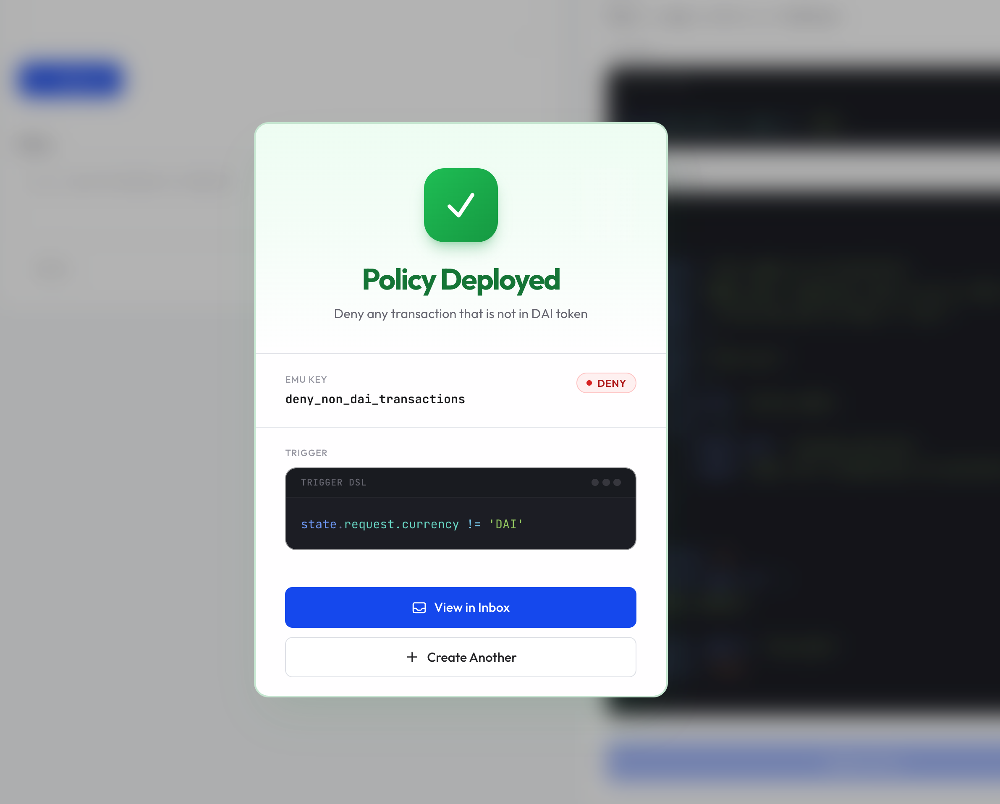

# OWS Policy Studio

A policy studio for [Open Wallet Standard](https://openwallet.wiki) agents. Author, test, and manage deterministic spend-gate policies powered by [Memrail SOMA AMI](https://memrail.com).

See live demo application at: https://ows-studio.memrail.com



Policies are **EMUs** (Executable Memory Units) — conditional rules that evaluate against structured context and produce allow/deny verdicts at the gate.

## Features

- **AI Composer** — Describe a policy in plain English, get a valid policies back. Refine iteratively.
- **Manual Editor** — Author policies directly in JSON with full trigger DSL control.
- **Gate Simulator** — Build atom contexts, fire test decisions, inspect verdicts. Includes presets for common scenarios.
- **Policy Inbox** — Browse, filter, and manage all registered policies.
- **Decision Traces** — Full audit trail of every gate decision.
- **Starter Pack** — Five pre-built policies for common spend-gate scenarios out of the box.




## Getting Started

```bash
# Install dependencies
make install

# Start dev servers (API on :8080, frontend on :3000)
make dev
```

### Environment Variables

| Variable | Description |
|----------|-------------|
| `MEMRAIL_ADMIN_API_KEY` | Memrail admin API key |
| `ANTHROPIC_API_KEY` | Anthropic API key (for AI composer) |
| `JWT_SECRET` | Session secret (auto-generated in dev) |

### First Run

1. Open `http://localhost:3000`
2. Enter your org and project name, then bootstrap
3. Starter policies are registered automatically — head to the Composer or Simulator

## Tech Stack

- **Frontend** — Next.js, React, TypeScript, Tailwind CSS, Zustand
- **Backend** — FastAPI, Python 3.12, Pydantic, httpx
- **Decision Engine** — Memrail SOMA AMI
